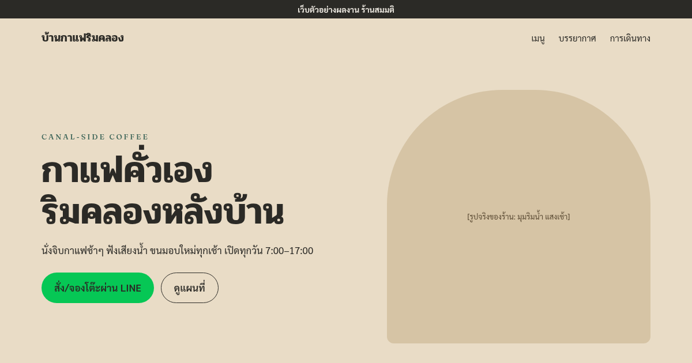

# บ้านกาแฟริมคลอง — B3 demo

Landing page ตัวอย่างผลงานของ **B3 Web Studio**  
ร้านกาแฟริมคลองแบบ static หน้าเดียว · **ข้อมูลทั้งหมดสมมติ** (ไม่มีเบอร์/LINE/ที่อยู่จริง)

> แถบด้านบน: `เว็บตัวอย่างผลงาน ร้านสมมติ` · `noindex,nofollow` · ลิงก์ติดต่อเป็น `#`



## Stack

| | |
|---|---|
| Framework | Astro 5 (static) |
| Style | Tailwind 3.4 |
| Fonts | Pridi · Fraunces · Sarabun (`@fontsource`, OFL) |
| Node | ≥ 18.20.8 (tested on 20.x) |

## โครงสร้าง

```
src/
  data/site.ts          # ข้อความทั้งหมด (แก้เนื้อหาที่นี่)
  data/illustrations.ts # alt ของภาพ line drawing
  components/           # Hero · WhyUs · Menu · Gallery · Visit · Footer
  layouts/Base.astro
  pages/index.astro
  styles/global.css
public/
  illustrations/        # SVG จาก DESIGNER (ไม่ใช้ stock photo)
  og.png · favicon.svg
```

## รันท้องถิ่น

```bash
npm ci
npm run dev -- --host 127.0.0.1 --port 4321
npm run build              # → dist/
npm run preview -- --host 127.0.0.1 --port 4322
```

## Deploy (Vercel)

| Setting | Value |
|---|---|
| Framework | Astro |
| Build | `npm run build` |
| Output | `dist` |
| Env (optional) | `SITE_URL=https://<โดเมน>` — ใช้กับ canonical / og:image |

ไม่ต้องมี secret อื่น

## หมายเหตุ

- รูปจริงของร้านใช้ placeholder / line illustration แทน stock
- เนื้อหาแก้ได้ที่ `src/data/site.ts`
- design tokens อยู่ที่ `tailwind.config.mjs`
